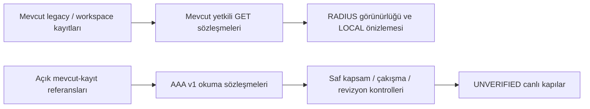

# Merkezi AAA veri modeli ve güvenli tasarım — v1

2026-11-11 · Tasarım ve izole, salt okunur sözleşmeler. Canlı entegrasyon yok.

Bu sözleşmeleri kullanan [bellek içi simülasyon ve 20 senaryolu kabul matrisi](AAA_MEMORY_SIMULATION.md)
ayrı, deterministik bir iz üretir; gerçek hesap veya audit kaydı değiştirmez.

## Mimari ve veri sahipliği

Tek FastAPI modüler monolit ve mevcut hesap sahibi korunur. Yeni bağımsız
abone deposu yoktur. `aaa_contracts.py` Pydantic okuma projeksiyonlarıdır;
ORM modeli, veritabanı tablosu, migration, endpoint, adapter veya job değildir.
Modül import'u bağlantı açmaz; dosya/DB yazmaz ve ağ/secret resolver çağırmaz.

Üst yol mevcut uygulamadır. Alt yol yeni, izole saf sözleşme sınırıdır; mevcut
GET'lere bağlayan yeni adapter/endpoint bu görevde eklenmedi. Ön yüzdeki NFKC
risk hipotezi backend canonical kimliği olarak kabul edilmez. Mevcut ekranın
hesap listesi ve dört sınıflı önizlemesi değiştirilmedi.

`models/subscriptions.py` içindeki `SubscriberAccount` mevcut alan modelidir:
customer/router/plan FK'leri, kaynak ve credential-reference ayrımı içerir.
`001` domain modeli ile `v2_demo` ve 007/008 depoları otomatik eşdeğer değildir.
Bu sürüm yalnız iki mevcut sentetik deponun açık referansını kabul eder.
Gerçek domain kayıtlarını tüketmek ayrı sürümlü projeksiyon/karar gerektirir.

## Açık veri sözleşmeleri

Kaynak: [aaa_contracts.py](../backend/app/integrations/aaa_contracts.py).
Tüm modeller strict, frozen, extra-forbid ve hata metninde input gizlidir.
`model_validate_json` JSON tarih/UUID biçimini doğrular. Python çağrıları gerçek
date/datetime/UUID tiplerini kullanır. Gizli bilgi, keyfi attributes, password,
RADIUS secret veya secret-reference alanı kabul edilmez. Yeni API yoktur;
gelecekte hata serileştirmesi de input/context hariç merkezi handler kullanmalıdır.

| Sözleşme | Alanlar ve sahiplik |
| --- | --- |
| AccountReference | Mevcut `store`, `account_id`, `revision`; açıkça sağlanırsa `subscription_id`, `tenant_id`. Legacy revizyon ≥0, workspace ≥1. Yeni ID üretilmez; hesap ID'si merkezi abonelik ID'sine kopyalanmaz. |
| AaaIdentity | `username_raw`, isteğe bağlı `realm`; `normalization=UNDECIDED/EXACT`, `username_canonical`. Realm kullanıcı adından ayrıştırılmaz. UNDECIDED canonical değer kabul etmez; EXACT orijinalden farklı değeri reddeder. |
| Authority / AccessType | Kaynak LOCAL/RADIUS/UNKNOWN; tür PPPoE/Hotspot/UNKNOWN ayrı, zorunlu alanlardır. UNKNOWN okuma/planlama durumudur; mevcut kalıcı tek-otorite CHECK kuralını genişletmez ve LOCAL fallback doğurmaz. |
| NasReference | Mevcut `router_id`; ayrı `nas_id`, `nas_identifier`, `mapping_revision`. Router referansı kendi sentetik deposunda kalır. Yönetim IP'si NAS yapılmaz. Varlık/eşleme her zaman UNVERIFIED. |
| ProfileReference | Mevcut plan referansı/adı; ayrı `aaa_profile_id`, mapping revizyonu ve attribute-policy sürümü. Paket adından profile otomatik dönüşüm yok; eşleme UNVERIFIED. |
| SubscriptionTerms | Kayıtlı date, Europe/Istanbul iş günü, açık expiration politikası ve isteğe bağlı aware UTC sınırı. ACTIVE/PAUSED/PENDING/UNKNOWN hesap durumudur; session_status yalnız UNKNOWN. |
| AaaSnapshot | v1, SYNTHETIC_READ_ONLY, üstteki referanslar ve açık uniqueness politikası. `external_writes` yalnız false; canlı verified bayrağı etkinleştirilemez. |
| PreviewScope | Güvenilir sunucu bağlamından actor/store/tenant, can_view router kapsamı veya mevcut workspace ADMIN sonucu. İstemci request body'sinden yetki olarak alınamaz. |
| PreviewProof | Kullanıcının/caller'ın verdiği request UUID, aktör, depo/hesap, beklenen revizyon ve snapshot SHA-256; sonuç yalnız PREVIEW_ONLY. İmzalı token, audit kaydı, uygulanmış işlem receipt'i veya taşıma izni değildir. |

Tarih kendiliğinden UTC'ye dönüştürülmez. `END_OF_DAY_INCLUSIVE` açıkça
seçilmiş ve UTC değeri sağlanmışsa değer ertesi yerel gün 00:00'ın UTC karşılığı
olmalıdır: örneğin 2026-12-23 bitişi → 2026-12-23T21:00:00Z sınırı.
Bu sınır exclusive'tir; Session-Timeout/aktif oturum sonlandırma komutu değildir.
Politika/tarih eksikse UTC alanı uydurulmaz; naive veya farklı sınır reddedilir.

## Kimlik çakışması ve yetki

`collision_key` yalnız açık EXACT canonical kullanıcı, tenant ve seçilen
`TENANT_REALM_EXACT` veya `TENANT_NAS_EXACT` politikasıyla üretilebilir.
İlkinde realm, ikincisinde ayrı NAS UUID gerekir. Tür anahtara otomatik
eklenmez: aynı AAA kimliğinin PPPoE/Hotspot kapsamı ayrıca kararlaştırılmalıdır.
Router ID NAS yerine geçmez. Politika/alan bilinmiyorsa key `None` döner;
bu çakışma yok demek değildir. Unicode/IDNA/case-fold için yeni policy
kararlaştırılmadan EXACT genişletilmez.

`inspect_aaa_snapshot` konu ve her peer için önce aynı depo/tenant ve mevcut
okuma yetkisini doğrular. Yetkisiz peer risk sayısını dahi sızdırmaz. Görünür
aynı anahtar yalnız risk üretir; canlı namespace benzersizliği kanıtlanmaz.
UNKNOWN/RADIUS LOCAL geçiş adayı olmaz. Merkezi abonelik, canlı kimlik,
NAS/profil, credential ve AAA yazma yetkisi sonuçları UNVERIFIED kalır.

Legacy kapsamı mevcut router `can_view`; workspace mevcut merkezi ADMIN'dir.
Okuma yetkisi gelecekteki AAA yazma yetkisine dönüşmez. Bu sözleşmede yeni
permission grant, realm/NAS yönetim yetkisi veya cihaz erişimi yoktur.

## Revizyon, idempotency ve audit akışı

1. Mevcut kayıt yetkili kaynaktan okunur; mevcut sahibi ve revizyon korunur.
2. Saf snapshot oluşturulur; eksikler UNKNOWN/None kalır. Önizleme sorgusu
   hiçbir hesap/audit oluşturmaz. Hash yalnız içerik eşitliği içindir.
3. `validate_preview_proof` sunucu kapsamı, aktör, depo/tenant, hesap, revizyon
   ve snapshot hash'ini yeniden kontrol eder; farkta durur.
4. Aynı request UUID ve aynı proof MATCH; değişmiş içerik/aktör/revizyon
   CONFLICT; farklı UUID UNRELATED'dır. Bu sonuçlar uygulandı anlamına gelmez.
   Kalıcı idempotency ledger veya atomik multi-request garanti eklenmedi.
5. Gelecekte gerçek plan namespace/peer güncelliğini, policy/mapping revizyonlarını,
   ön-imajı ve hedef sistem kanıtını da bağlamalıdır. Mevcut hash tek hesap
   snapshot'ına aittir; diğer hesapların değişmediğini veya kanıtın hâlâ güncel
   olduğunu tek başına ispatlamaz. TTL/imza/kalıcı saklama kararı henüz yoktur.

Mevcut yerel account+event+request transaction sınırı korunur. Gelecek AAA
yan etkisi panel DB transaction'ıyla atomik değildir. Audit'in minimumu:
request/plan kimliği, aktör ve yetki bağlamı, tenant, hesap/abonelik, eski/yeni
otorite ve revizyon, policy/mapping sürümleri, güvenli ön-imaj/son-imaj özeti,
UTC zaman, APPLIED/REJECTED/UNKNOWN kanıtı ve dış sistem correlation ID'si.
Ham credential/attribute dump'ı veya secret loglanmaz. Ağ timeout'u başarı
veya uygulanmadı olarak çevrilmez; idempotent GET uzlaştırma/outbox seçimi
ayrı tasarım ve onay gerektirir. Burada böyle bir yazma yolu yoktur.

## Şema gereksinimleri — uygulanmadı

- Mevcut account/customer/plan/router sahipleri tek kaynak kalmalı. Gerekirse
  account'a bağlı abonelik süresi/revizyon metadata'sı eklemeli tasarlanmalı;
  ikinci bağımsız subscriber/accounts tablosu veya demo kopyası oluşturulmamalı.
- Merkezi abonelik ID'sinin sahibi ve mevcut account ile cardinality kararı,
  tenant/realm benzersizliği ve geçerli tek otorite constraint'i netleşmeli.
- NAS↔router ve plan↔AAA profile eşlemeleri sürümlü, tenant kapsamlı referanslar
  olmalı; gerçek eşleme onayı/kanıtı ayrı tutulmalı. Secret mevcut güvenli
  referans servisinin sorumluluğu; bu okuma sözleşmesinde içerik/ref bulunmaz.
- Gelecekteki idempotency/audit/outbox için benzersiz anahtar, aktör kapsamı,
  result retention ve state machine belirlenmeli. Bu belge uygulanabilir DDL
  değildir; migration ve gerçek katalog kabulü yapılmadı.

## Geri dönüş ve canlı entegrasyon öncesi kararlar

Geri dönüş otomatik source flip, kör kayıt overwrite veya tüm DB restore
değildir. LOCAL ön-imaj ve credential sahipliği korunmalı; hedef AAA hesabı,
mevcut oturumlar ve sonradan değişmiş revizyonlar bilinmeden ikinci aktif
otorite açılmamalıdır. Belirsiz dış sonuçta durulur ve salt okunur uzlaştırma
istenir; geri dönüş işlemi ayrıca onaylanmış kapsam ve audit gerektirir.

Açık kararlar: account/abonelik ID sahipliği; tenant/realm/NAS namespace'i ve
username/Unicode/IDNA politikası; paket→AAA attribute sürümü; bitiş ve oturum
politikası; NAS kimliği/eşleme kanıtı; hedef FreeRADIUS sürümü ve SQL/API okuma
sınırı; güvenli taşıma/secret store/minimum servis rolü; ayrı AAA yazma yetkisi;
distributed işlem/idempotency/uzlaştırma/audit saklama ve geri dönüş yöntemi.
Canlı bağlantı, credential erişimi, DB yazımı, migration, taşıma ve deploy için
ayrı açık hedefe özgü kullanıcı onayı gerekir. Önizleme onay oluşturmaz.

## Doğrulama kapsamı

İzole sentetik model testleri kaynak/tür ayrımı, bilinmeyen bilgi, EXACT politika,
NAS/realm key, yetkisiz tenant/depo/router/peer, UTC sınırı, stale proof,
UUID conflict, sır/yazma alanlarının reddi ve frozen JSON roundtrip'i kapsar.
Mevcut RADIUS/önizleme frontend regresyonları korunur. Gerçek PostgreSQL,
HTTP/tarayıcı ve canlı AAA kabulü **PENDING / uygulanmadı**; socket EPERM
tekrarlanmaz. Mevcut 11 abone/admin/audit ve yedek üzerinde işlem yoktur.

## İzole kalıcılık tasarımının devamı

[AAA işlem günlüğü prototipi](AAA_OPERATION_JOURNAL.md) tenant kapsamlı
idempotency, atomik operation/event ve CAS modelini geçici SQLite testlerinde
sınar. Yukarıdaki geçici proof tek başına kalıcılık sağlamaz. Bu ek prototip
PostgreSQL'e bağlı değildir; uygulanan migration veya gerçek AAA yürütücüsü yoktur.

[Entegrasyon hazırlığı](AAA_INTEGRATION_PREPARATION.md) yeni canlı yetki veya
executor eklemeden sahte adaptör gözlemi, kapalı hedef/source fence sırası ve
revizyon/telafi kararlarını tanımlar. Mevcut demo UI ve canlı UNVERIFIED kapıları
korunur; hazırlık çıktısını kalıcı journal'a bağlamak ayrı sürümlü tasarım ister.
